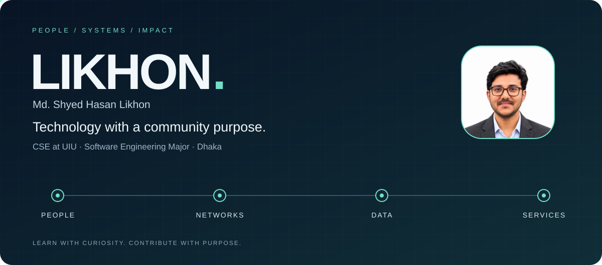
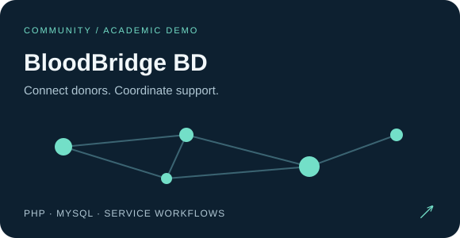
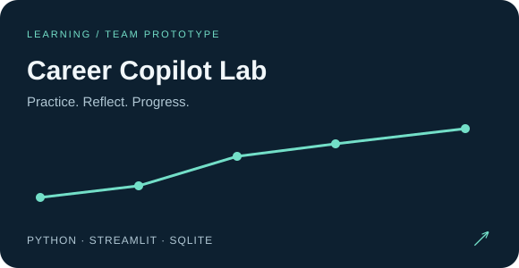

# Hello, I’m Likhon.

**CSE Undergraduate @ UIU · Major in Software Engineering · Networking & Information Systems · Technology for Social Impact**

I study Computer Science and Engineering at United International University, Dhaka. I have completed **105 of 138 credits**, with expected graduation in **Summer 2027**.

I am majoring in Software Engineering, with interests in networking, databases, and information systems. I am exploring entry-level opportunities where I can apply technical knowledge, teamwork, and community experience to practical challenges.

[Portfolio](https://mshlikhon.github.io/) · [LinkedIn](https://www.linkedin.com/in/md-shyed-hasan-likhon-2133851a5/) · [Email](mailto:myselfmshl@gmail.com)

## Skills & tools

- **Networking:** Cisco Packet Tracer, IP addressing, router and switch fundamentals.
- **Programming & web:** C, Python, HTML, PHP.
- **Databases:** MySQL, SQL, ER diagrams, schema design.
- **Design & collaboration:** Figma, Git, GitHub, VS Code, Microsoft Office.
- **Professional strengths:** Teamwork, communication, event logistics, volunteer coordination, public speaking.

## Selected projects

### [BloodBridge BD](https://github.com/MSHLIKHON/BloodBridge-BD)
An academic **PHP and MySQL** demo for blood-donation coordination, with donor search, request workflows, hospital inventory, role-based dashboards, and reporting.

### [Career Copilot Lab](https://github.com/MSHLIKHON/career_copilot_lab)
A team classroom prototype using **Python, Streamlit, and SQLite**, with practice tasks, progress tracking, skill-gap exploration, and machine-learning feedback.

### [Mayor’s Rise](https://github.com/ashad-abir/Mayor-s-Rise)
A collaborative **Java** project from the Advanced OOP Laboratory. Contributions included planning, program structure, data handling, and applying object-oriented concepts.

### [Personal Portfolio](https://mshlikhon.github.io/)
My projects, education, leadership activities, and contact details. [View source](https://github.com/MSHLIKHON/mshlikhon.github.io).

## Leadership & community

- **Deputy Logistics, UIU Social Services Club** — 2024–2026.
- **General Member, UIU App Forum** — 2023–Present.
- **Founder & Volunteer, Personal Social Welfare Initiative** — 2020–Present; relief and community support.
- **General Secretary, National Children’s Task Force, school branch** — August 2017–February 2018; children’s rights and welfare initiatives.

## Continuing learning

Grameenphone Academy skill development courses and professional workshops. [View certificates](https://drive.google.com/drive/folders/1-tNXgIcSrWGG24EfCFrsKpNAvmtIfNsZ?usp=share_link).

Based in **Dhaka, Bangladesh**. Open to entry-level opportunities, learning, and collaboration.

---

