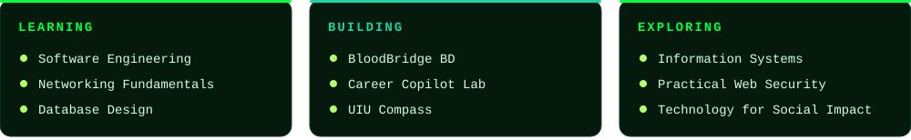

<!-- Generated by DevVerse (https://github.com/Muhtasim-Masum-Hasnayen/devverse-profile) -- do not edit this file, edit config.yml -->

| Project | Stack / context | What it does |
| :--- | :--- | :--- |
| [**BloodBridge BD**](https://github.com/MSHLIKHON/BloodBridge-BD) | PHP · MySQL | Academic blood-donation coordination demo with donor search, request workflows and role-based dashboards. |
| [**Career Copilot Lab**](https://github.com/MSHLIKHON/career_copilot_lab) | Python · Streamlit · SQLite | Team classroom prototype for practice tasks, progress tracking and skill-gap exploration. |
| [**UIU Compass**](https://github.com/MSHLIKHON/uiu-compass) | Academic planning | A planning tool for UIU students. |
| [**Mayor’s Rise**](https://github.com/ashad-abir/Mayor-s-Rise) | Java · Collaborative coursework | Advanced OOP Laboratory project; contributions in planning, program structure and data handling. |

[Explore my portfolio →](https://mshlikhon.github.io/)

**Technology with a community purpose.** I study CSE at United International University, majoring in Software Engineering. Expected graduation: **Summer 2027**.

- **Deputy Logistics · UIU Social Services Club** — 2024–2026.
- **General Member · UIU App Forum** — 2023–Present.
- **Founder & Volunteer · Personal Social Welfare Initiative** — 2020–Present; relief and community support.
- **General Secretary · National Children’s Task Force (school branch)** — August 2017–February 2018.

**Open to entry-level opportunities, learning and collaboration.** [Connect on LinkedIn](https://www.linkedin.com/in/md-shyed-hasan-likhon-2133851a5/).

 

Like this profile? ⭐ <b>star the template</b> and 👤 <b>follow <a href="https://github.com/Muhtasim-Masum-Hasnayen">@Muhtasim-Masum-Hasnayen</a></b> to support the creator.

