<!-- Generated from profile.json by scripts/build_profile.py. -->

<a href="https://mshlikhon.github.io/">Portfolio</a> &nbsp; / &nbsp; <a href="https://www.linkedin.com/in/md-shyed-hasan-likhon-2133851a5/">LinkedIn</a> &nbsp; / &nbsp; <a href="mailto:myselfmshl@gmail.com">Email</a> &nbsp; / &nbsp; <a href="https://github.com/MSHLIKHON?tab=repositories">Repositories</a>

### Selected work

Practical tools, community systems and experiments I learn from.

**Also built:** [Personal portfolio](https://mshlikhon.github.io/) · [Medical portfolio](https://github.com/MSHLIKHON/dr-pritom-medical-portfolio). **Team coursework:** [Mayor’s Rise](https://github.com/ashad-abir/Mayor-s-Rise), a collaborative Java OOP project.

More about my community work and continuing learning

- **National Children’s Task Force, school branch** — General Secretary, August 2017–February 2018; children’s rights and welfare initiatives.
- **Personal Social Welfare Initiative** — Relief and community support.
- **Continuing learning** — Grameenphone Academy skill development courses and professional workshops. [Certificates](https://drive.google.com/drive/folders/1-tNXgIcSrWGG24EfCFrsKpNAvmtIfNsZ?usp=share_link).

Explore my contribution terrain

